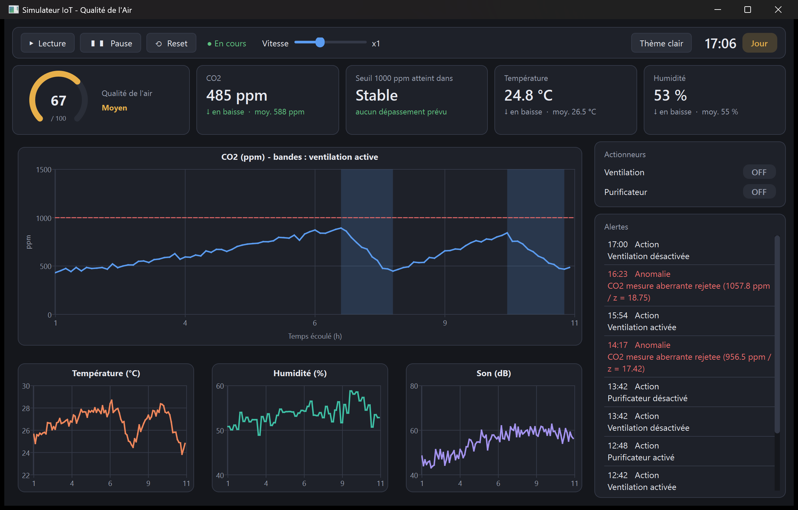
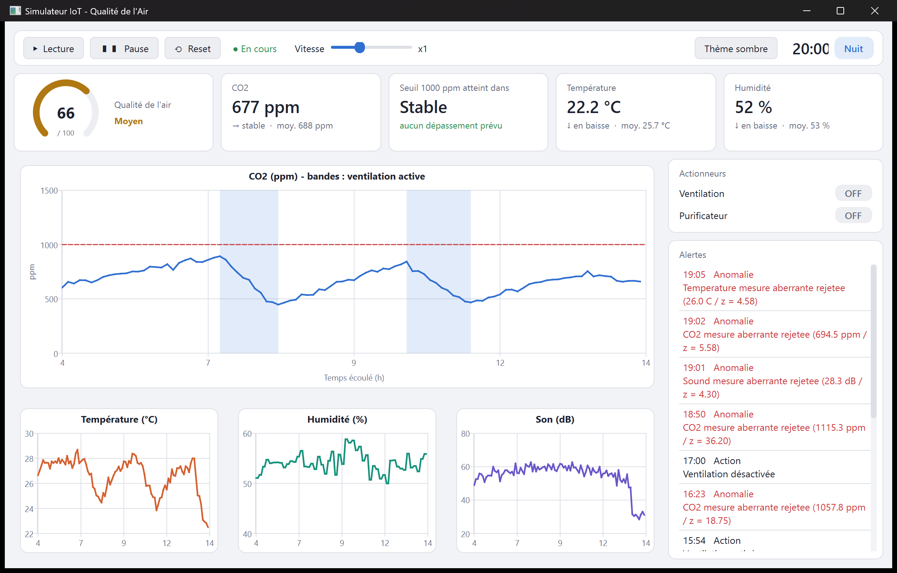
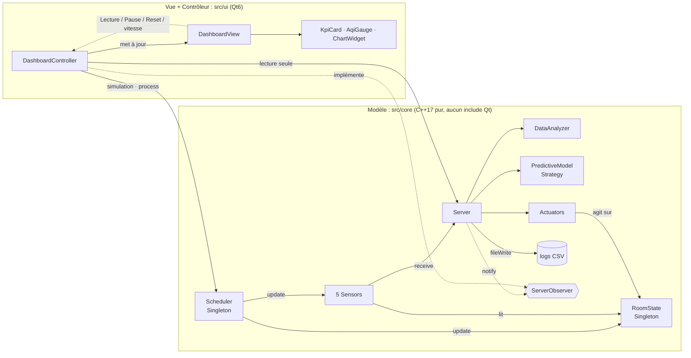
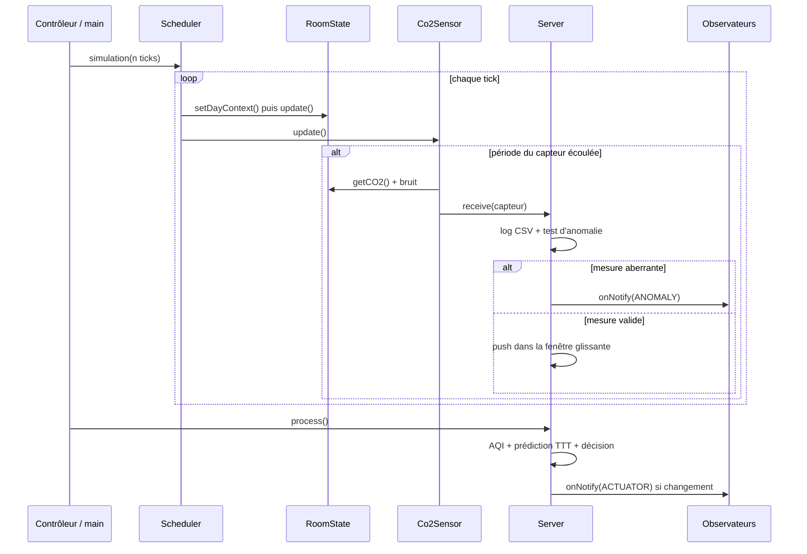

# Simulateur d'Écosystème IoT & Qualité de l'Air


> Des capteurs virtuels mesurent l'air d'une pièce, un serveur analyse les mesures et allume la ventilation
> quand il le faut, et un tableau de bord Qt affiche tout ça en temps réel.



---

## Table des matières

1. [Introduction](#1-introduction)
2. [Contexte : d'un TP à un produit](#2-contexte--dun-tp-à-un-produit)
3. [Problématique](#3-problématique)
4. [Objectifs](#4-objectifs)
5. [Fonctionnalités en un coup d'œil](#5-fonctionnalités-en-un-coup-dœil)
6. [Stack technique](#6-stack-technique)
7. [Architecture](#7-architecture)
8. [Choix de conception expliqués](#8-choix-de-conception-expliqués)
9. [Structure du dépôt](#9-structure-du-dépôt)
10. [Installation et lancement](#10-installation-et-lancement)
11. [Guide d'utilisation](#11-guide-dutilisation)
12. [Paramétrage de la simulation](#12-paramétrage-de-la-simulation)
13. [Problèmes rencontrés et solutions](#13-problèmes-rencontrés-et-solutions)
14. [Validation et tests](#14-validation-et-tests)
15. [Limites connues](#15-limites-connues)
16. [Perspectives](#16-perspectives)
17. [Ce que ce projet m'a appris](#17-ce-que-ce-projet-ma-appris)
18. [Conclusion](#18-conclusion)
19. [Glossaire](#19-glossaire)
20. [Auteur](#20-auteur)

---

## 1. Introduction

C'est un simulateur IoT en C++17 qui surveille la qualité de l'air d'une salle de travail.

Tout est simulé, mais on retrouve les mêmes étapes que dans un vrai système IoT :

- des capteurs (température, humidité, CO2, son, lumière), qui mesurent chacun à leur rythme, avec un peu de bruit comme en vrai ;
- un ordonnanceur qui fait tourner tous ces capteurs ;
- un serveur qui reçoit les mesures, les enregistre, écarte les valeurs fausses, calcule un indice de qualité de l'air et essaie de prévoir quand le CO2 va devenir trop haut ;
- des actionneurs (ventilation, purificateur) qui agissent sur la pièce ;
- un tableau de bord Qt pour voir tout ça en direct.

Pas besoin de matériel, tout tourne sur un PC. Ça m'a permis de comprendre comment les différentes parties d'un système IoT communiquent entre elles avant de toucher un jour à de vrais capteurs.

---

## 2. Contexte : d'un TP à un produit

### 2.1 L'origine

Tout est parti d'un TP du cours de programmation orientée objet en C++ à l'UTBM (Université de Technologie de Belfort-Montbéliard).

Dans le TP, il fallait coder un serveur, des capteurs et un ordonnanceur pour simuler un petit réseau IoT, et utiliser ce qu'on voyait en cours :
- la forme canonique de Coplien ;
- l'héritage, le polymorphisme et les classes abstraites ;
- la surcharge d'opérateurs ;
- la STL ;
- l'écriture de logs.

En le faisant, j'ai eu envie d'aller plus loin. Un programme qui tire des nombres au hasard et les écrit dans des fichiers, ça marche, mais ça ne ressemble pas vraiment à un système de surveillance. Je voulais une pièce qui réagit, un serveur qui prend des décisions tout seul, la détection des mesures fausses et une vraie interface. J'ai donc repris le TP à ma façon, comme je voyais le produit fini, et c'est devenu un projet perso pour apprendre l'IoT.

### 2.2 Du TP au produit

| Aspect | Dans le TP | Ce que j'ai ajouté |
|---|---|---|
| Capteurs | Valeurs aléatoires indépendantes | Capteurs qui lisent une pièce simulée physiquement, avec bruit gaussien et pannes simulées |
| Temps | Un compteur de ticks | Double base de temps + horloge murale `<chrono>` accélérée, cycle jour/nuit, horodatage ISO 8601 |
| Serveur | Réception et écriture de logs | Filtrage des aberrations, AQI, prédiction du dépassement de seuil, décision autonome |
| Environnement | Inexistant | `RoomState` : CO2, température, humidité, son, occupants qui évoluent selon l'heure |
| Actionneurs | Inexistants | Ventilation et purificateur qui modifient réellement la pièce, avec hystérésis |
| Alertes | Affichage console | Pattern Observer : alertes diffusées à la console, au fichier et à l'interface |
| Interface | Console uniquement | Tableau de bord Qt6 (MVC strict) : jauge AQI, tendances, graphiques annotés, thème clair/sombre |
| Documentation | - | Diagrammes UML PlantUML, captures, ce README |

---

## 3. Problématique

On passe beaucoup de temps dans des salles fermées : bureaux, salles de cours, open spaces. Plus il y a de monde, plus le CO2 monte, la température aussi, et l'humidité bouge. Au-dessus d'environ 1000 ppm de CO2, on considère en général que l'air n'est pas assez renouvelé, et on le sent : fatigue, difficulté à se concentrer.

Un système IoT peut régler ça : il mesure, il analyse, il agit. Mais quand on essaie d'en faire un, plein de questions arrivent :

1. Comment faire marcher ensemble des capteurs qui ne mesurent pas la même chose ni au même rythme ?
2. Comment savoir si une mesure est fausse (un capteur qui « saute ») sans jeter les vraies variations ?
3. Quand allumer la ventilation, sans réagir trop tard et sans qu'elle s'allume et s'éteigne sans arrêt ?
4. Est-ce qu'on peut prévoir le moment où le seuil va être dépassé, au lieu d'attendre qu'il le soit ?
5. Comment afficher tout ça pour qu'on comprenne d'un coup d'œil ce qui se passe ?
6. Et comment organiser le code C++ pour qu'il reste propre, facile à faire évoluer et indépendant de l'interface ?

Ce projet, c'est ma façon de répondre à ces questions, dans un environnement simulé où je contrôle tout.

---

## 4. Objectifs

Voici ce que je voulais atteindre avec ce projet.

### 4.1 Côté C++

- Faire un vrai ensemble de classes qui travaillent ensemble : `Server`, `Scheduler`, `Sensor` et les capteurs qui en héritent.
- Utiliser la forme de Coplien sur `Server` et réfléchir à ce qu'une copie doit garder ou non.
- Me servir de l'héritage, du polymorphisme, des classes abstraites et des interfaces.
- Surcharger `operator<<` pour afficher les objets dans la console ou dans un fichier.
- Utiliser la STL (`map`, `deque`, `vector`, les algorithmes), `<chrono>` et `<random>`.
- Ne pas avoir de fuite mémoire, grâce aux `std::unique_ptr` et à des règles claires sur qui possède quoi.
- Compiler sous Windows et Linux avec CMake, sans aucun warning.

### 4.2 Côté IoT et données

- Simuler une pièce assez réaliste pour que les mesures aient du sens.
- Calculer un indice de qualité de l'air (AQI).
- Prévoir dans combien de temps le CO2 va dépasser le seuil (régression linéaire).
- Repérer et écarter les mesures fausses (z-score) sans confondre une panne avec une vraie variation.
- Allumer et éteindre les actionneurs tout seul, sans que ça clignote (hystérésis).
- Enregistrer des logs CSV avec l'heure, faciles à ouvrir dans Excel ou avec Python.

### 4.3 Côté interface

- Un tableau de bord Qt6 clair, qu'on comprend en un coup d'œil.
- Une architecture MVC stricte : le cœur du programme n'utilise jamais Qt.
- Des design patterns seulement là où ils servent vraiment : Factory, Strategy, Singleton, Observer.
- Documenter l'architecture (UML) et expliquer mes choix (ce README).

---

## 5. Fonctionnalités en un coup d'œil

| Domaine | Fonctionnalité |
|---|---|
| Simulation | 5 capteurs à fréquences propres · pièce simulée (CO2, température, humidité, son, lumière, occupants) · cycle jour/nuit · journée complète en 24 secondes dans l'interface |
| Analyse | Fenêtre glissante de 20 mesures · moyenne, écart-type, min, max · indice AQI sur 100 |
| Prédiction | Régression linéaire sur le CO2 → temps avant 1000 ppm, en minutes |
| Fiabilité | Détection d'anomalies par z-score sur les variations · rejet des pics isolés · pannes simulées pour le démontrer |
| Décision | Purificateur puis ventilation, en escalade, avec hystérésis anti-oscillation |
| Alertes | Seuil CO2 franchi, anomalie, changement d'état d'un actionneur → console, fichier, interface |
| Logs | 8 fichiers CSV horodatés ISO 8601 |
| Interface | Jauge AQI · cartes avec tendances · graphique CO2 avec seuil et bandes de ventilation · 3 graphiques secondaires · journal d'alertes · vitesse ×0,5 à ×4 · thème clair/sombre · Reset complet |
| Deux exécutables | `simulator_core` (console, sans Qt) et `simulator_gui` (tableau de bord) |

<details>
<summary>Voir le tableau de bord en thème clair</summary>



</details>

---

## 6. Stack technique

| Brique | Choix | Pourquoi |
|---|---|---|
| Langage | C++17 | Langage du cours et standard moderne : `unique_ptr`, `std::clamp`, *structured bindings*, `std::filesystem` |
| Build | CMake ≥ 3.20 + Ninja | Tout le monde l'utilise, ça marche sous Windows et Linux, et Visual Studio, VS Code et Qt Creator le lisent directement |
| Interface | Qt 6 Widgets | Mature, natif, performant ; plus adapté qu'un QML pour un tableau de bord orienté données en C++ pur |
| Graphiques | Qt Charts | Courbes temps réel, séries d'aires (bandes) et axes configurables, sans dépendance externe |
| Style | QSS (feuilles de style Qt) | Thèmes clair et sombre centralisés, sans couleur codée en dur dans les widgets |
| Compilateurs | MSVC 2022 (`/W4 /permissive- /utf-8`), GCC (`-Wall -Wextra -Wpedantic`) | Niveau d'avertissement maximal pour un code propre |
| Bibliothèque standard | STL, `<chrono>`, `<random>`, `<filesystem>` | Aucune dépendance tierce pour le cœur |
| Documentation | PlantUML | Diagrammes UML versionnés en texte, lisibles dans un diff |
| Analyse mémoire | Valgrind (WSL / Linux) | Vérification de l'absence de fuites |
| Versionnement | Git / GitHub | - |

Le cœur de la simulation (`src/core/`) n'utilise que la bibliothèque standard : il compile et tourne même sans Qt installé.

---

## 7. Architecture

### 7.1 Vue d'ensemble (MVC)



**Règle stricte** : le dossier `src/core/` ne contient aucun `#include <Q...>`. Qt est cantonné à `src/ui/`. La version console (`simulator_core`) et le tableau de bord (`simulator_gui`) partagent exactement le même cœur.

### 7.2 Les composants

| Composant | Nature | Rôle |
|---|---|---|
| `Server` | Classe (forme de Coplien) | Reçoit les mesures, journalise, filtre, analyse, décide, notifie |
| `Sensor` | Classe abstraite | Processus de mesure autonome, avec sa base de temps interne |
| `TemperatureSensor`, `HumiditySensor`, `Co2Sensor`, `SoundSensor`, `LightSensor` | Spécialisations | Chacune implémente `generateValue()` |
| `SensorFactory` | Fabrique | Crée un capteur à partir de son nom (`"CO2"`, `"Humidity"`…) |
| `Scheduler` | Singleton | Anime capteurs et pièce ; autorité temporelle de la simulation |
| `SimClock` | Utilitaire | Constantes de temps et conversions `<chrono>` / ISO 8601 |
| `RoomState` | Singleton | État physique de la pièce et ses lois d'évolution |
| `DataAnalyzer` | Classe | Fenêtre glissante, statistiques, AQI |
| `PredictiveModel` | Interface | Stratégies d'analyse : `LinearRegressionModel`, `AnomalyDetectorModel` |
| `Actuator` | Interface | `VentilationSystem`, `AirPurifier` |
| `ServerObserver` | Interface | Abonnés aux alertes : `ConsoleAlertObserver`, `DashboardController` |
| `DashboardController` | Contrôleur Qt | Cadence la simulation, alimente la vue, relaie les alertes |
| `DashboardView` | Vue Qt | Mise en page du tableau de bord |
| `Theme`, `KpiCard`, `AqiGauge`, `ChartWidget` | Composants Qt | Palette et QSS, carte d'indicateur, jauge dessinée, graphique annoté |

Les diagrammes UML détaillés se trouvent dans [`docs/uml/`](docs/uml/) :
- [classes](docs/uml/01_classes.puml) ;
- [séquence d'un tick](docs/uml/02_sequence_tick.puml) ;
- [composants MVC](docs/uml/03_composants_mvc.puml).

### 7.3 Déroulement d'un pas de simulation



### 7.4 Le temps dans la simulation

Le temps, c'est la partie la plus piégeuse. Il y a trois niveaux :

| Niveau | Porté par | Valeur |
|---|---|---|
| Tick global | `Scheduler` | 1 tick = 100 ms de temps « capteur » |
| Période propre | chaque `Sensor` | CO2 500 ms · son 800 ms · température 1000 ms · lumière 1500 ms · humidité 2000 ms |
| Horloge murale | `SimClock` | Accélérée ×360 : 1 tick = 36 s, 1 heure = 100 ticks, 1 journée = 2400 ticks |

À chaque tick, le `Scheduler` appelle `update()` sur tous les capteurs ; chaque capteur n'appelle réellement `execute()` (donc ne mesure) que lorsque sa propre période est écoulée. La simulation démarre le jour courant à 06:00 (heure locale) et tous les logs sont horodatés selon cette horloge.

### 7.5 La pièce simulée (`RoomState`)

| Grandeur | Loi d'évolution (par tick) |
|---|---|
| Occupants | Courbe sinusoïdale selon l'heure : 2 personnes le matin, pic de 13 vers 14 h, 0,5 la nuit (gardien) |
| CO2 | +0,20 ppm par occupant · renouvellement naturel proportionnel à l'écart avec l'air extérieur (400 ppm) · −5 ppm avec la ventilation · −1,5 ppm avec le purificateur |
| Température | Tend vers 26 °C le jour et 19 °C la nuit, vers 20 °C sous ventilation, + apport des occupants |
| Humidité | Tend vers 50 % (+ occupants), 45 % avec le purificateur, 40 % sous ventilation |
| Son | 40 dB le jour + 1,5 dB par occupant ; 30 dB la nuit |
| Lumière | 1 le jour, 0 la nuit |

Les capteurs lisent cet état en y ajoutant un bruit gaussien réaliste (±15 ppm pour le CO2, ±0,3 °C pour la température…). Le capteur de CO2 simule aussi une panne dans 1 % des mesures : un pic parasite de +400 ppm.

### 7.6 Analyse, prédiction et décision

**Indice de qualité de l'air (AQI, 0 à 100)** : moyenne pondérée de trois sous-scores.

| Composante | Poids | Score |
|---|---|---|
| CO2 | 60 % | 100 à 400 ppm, 0 à 1500 ppm, linéaire entre les deux |
| Température | 20 % | 100 à 22 °C, −20 points par degré d'écart |
| Humidité | 20 % | 100 à 50 %, −5 points par point d'écart |

**Prédiction (*Time-to-Threshold*)** : une régression linéaire sur les 20 dernières mesures de CO2 estime quand la courbe atteindra 1000 ppm. Le résultat est converti en minutes simulées. Il est ignoré s'il dépasse 4 heures (trop incertain) ou si la fenêtre contient moins de 10 mesures.

Décision, en escalade et avec hystérésis :

| Actionneur | S'allume si… | S'éteint si… |
|---|---|---|
| Purificateur (action légère) | AQI < 52 | AQI ≥ 62 |
| Ventilation (action forte, énergivore) | TTT < 60 min ou AQI < 50 ou CO2 moyen > 1000 ppm | CO2 moyen < 650 ppm et AQI ≥ 60 |

Alertes diffusées à tous les observateurs : franchissement du seuil de 1000 ppm (à la montée et à la descente uniquement), mesure aberrante rejetée, changement d'état d'un actionneur.

### 7.7 Les logs

```
logs/
├── temperature.csv   # timestamp,id,type,value,unit
├── humidity.csv
├── co2.csv
├── sound.csv
├── light.csv
├── predictions.csv   # timestamp,kind,value,unit   (AQI, TTT en min, ANOMALY_<type>)
├── actuators.csv     # timestamp,actuator,state     (ON / OFF)
└── alerts.csv        # timestamp,category,message   (notifications Observer)
```

Les CSV des capteurs contiennent toutes les mesures brutes, y compris celles rejetées comme aberrantes, pour garder une trace complète. Les fichiers sont recréés à chaque lancement et à chaque Reset.

---

## 8. Choix de conception expliqués

### Pourquoi séparer le cœur en C++ pur et l'interface Qt ?
Comme ça la même simulation tourne en console et dans l'interface, et on pourrait la faire tourner ailleurs plus tard sans rien changer. Et ça oblige à garder les choses à leur place : la vue affiche, elle ne décide rien.

### Pourquoi `Scheduler` et `RoomState` sont des singletons, mais pas `Server` ?
Il n'y a qu'une horloge et qu'une pièce, donc un singleton a du sens. Le `Server`, par contre, doit rester une classe normale qu'on peut copier (forme de Coplien) : on pourrait très bien avoir un serveur par pièce un jour. Je le crée dans `main()` et je donne son adresse aux capteurs.

### Pourquoi le pattern Strategy pour les algos ?
Aujourd'hui c'est une régression linéaire, demain ce sera peut-être autre chose. Le `Server` ne sait pas quel algo il utilise, on le lui donne avec `setPredictor()` ou `setAnomalyDetector()`. Pour ajouter un nouveau modèle, je n'ai pas à toucher au serveur.

### Pourquoi un Observer pour les alertes ?
Une alerte doit aller à plusieurs endroits : la console, le fichier `alerts.csv`, le tableau de bord, et peut-être un mail plus tard. Le serveur envoie l'alerte sans savoir qui écoute. Chacun s'inscrit avec `attach()` et se désinscrit avec `detach()`.

### Pourquoi une Factory pour les capteurs ?
Pour créer un capteur juste avec son nom (`"CO2"`), par exemple depuis un fichier de config plus tard, sans avoir à connaître toutes les classes.

### Pourquoi l'horloge va 360 fois plus vite ?
Avec 1 tick = 100 ms, il faudrait attendre 24 vraies heures pour voir passer une journée. En accélérant, on voit une journée entière en 24 secondes, et les périodes des capteurs restent en millisecondes.

### Pourquoi le z-score est calculé sur les écarts et pas sur les valeurs ?
Au début je comparais chaque valeur à la moyenne. Résultat : dès que le CO2 montait normalement, chaque nouvelle mesure était vue comme anormale. En regardant l'écart entre deux mesures qui se suivent, une montée normale donne des petits écarts réguliers, alors qu'une mesure fausse donne un gros saut d'un coup. Le bug est expliqué en [13.9](#139-détecteur-danomalies-qui-rejette-les-tendances).

### Pourquoi une hystérésis ?
Avec un seul seuil, la ventilation s'allume et s'éteint sans arrêt autour de la limite. Avec un seuil pour allumer et un autre pour éteindre, ça se stabilise. C'est ce que fait un thermostat.

### Pourquoi la vitesse change le timer et pas le nombre de ticks ?
Le curseur change juste le temps entre deux images (de 200 ms à 25 ms). Le nombre de ticks entre deux analyses ne bouge pas, donc le serveur prend exactement les mêmes décisions à toutes les vitesses. On regarde la même simulation, juste plus ou moins vite.

### Pourquoi des `std::unique_ptr` ?
On voit tout de suite qui possède quoi : le `Scheduler` possède les capteurs, le `Server` ses algos et ses actionneurs. Pas de `delete` à écrire, pas de fuite, et le compilateur bloque les copies par erreur.

### Pourquoi des CSV avec des dates ISO 8601 ?
C'est le plus simple à ouvrir partout : Excel, LibreOffice, Python. Et les dates ISO 8601 se trient dans le bon ordre sans rien faire.

### Pourquoi le chemin des logs est généré par CMake ?
Sinon les logs se retrouvent dans le dossier d'où on lance le programme, et ça change selon l'éditeur. CMake écrit le chemin du projet dans `Config.h`, donc les logs vont toujours dans `logs/` à la racine.

### Pourquoi Qt Widgets et pas QML ?
Tout le projet est en C++ et le tableau de bord, c'est surtout des chiffres et des courbes. Avec Qt Widgets et du QSS, je reste en C++ du début à la fin et j'arrive quand même à avoir une interface moderne.

---

## 9. Structure du dépôt

```
.
├── CMakeLists.txt                 # Build : cible console + cible GUI (si Qt trouvé)
├── README.md
├── .gitignore
│
├── include/
│   ├── core/                      # En-têtes du cœur (C++ pur)
│   │   ├── Config.h.in            # Modèle CMake → Config.h (chemin racine)
│   │   ├── SimClock.h             # Base de temps <chrono>
│   │   ├── Scheduler.h            # Ordonnanceur (Singleton)
│   │   ├── RoomState.h            # Pièce simulée (Singleton)
│   │   ├── Sensor.h               # Capteur abstrait
│   │   ├── TemperatureSensor.h  HumiditySensor.h  Co2Sensor.h
│   │   ├── SoundSensor.h  LightSensor.h
│   │   ├── SensorFactory.h        # Fabrique de capteurs
│   │   ├── Server.h               # Serveur central (Coplien)
│   │   ├── DataAnalyzer.h         # Fenêtre glissante + AQI
│   │   ├── PredictiveModel.h      # Interface Strategy
│   │   ├── LinearRegressionModel.h  AnomalyDetectorModel.h
│   │   ├── Actuator.h             # Interface actionneur
│   │   ├── VentilationSystem.h  AirPurifier.h
│   │   ├── ServerObserver.h       # Interface Observer + Notification
│   │   └── ConsoleAlertObserver.h
│   │
│   └── ui/                        # En-têtes de l'interface (Qt)
│       ├── Theme.h                # Palettes + feuille QSS
│       ├── KpiCard.h              # Carte d'indicateur
│       ├── AqiGauge.h             # Jauge AQI (QPainter)
│       ├── ChartWidget.h          # Graphique avec seuil et bandes
│       ├── DashboardView.h        # Fenêtre principale
│       └── DashboardController.h  # Contrôleur MVC
│
├── src/
│   ├── core/*.cpp                 # Implémentations du cœur
│   ├── ui/*.cpp                   # Implémentations Qt
│   ├── main_core.cpp              # Point d'entrée console
│   └── main_qt.cpp                # Point d'entrée tableau de bord
│
├── docs/
│   ├── uml/                       # Diagrammes PlantUML
│   └── captures/                  # Captures du tableau de bord
│
└── logs/                          # CSV générés à l'exécution (non versionnés)
```

---

## 10. Installation et lancement

Cette section part de zéro : du clonage du dépôt jusqu'au lancement dans ton éditeur.

### 10.1 Prérequis

| Outil | Version | Rôle | Obligatoire |
|---|---|---|---|
| Git | récente | Cloner le dépôt | Oui |
| Compilateur C++17 | MSVC 2022+ (Windows) ou GCC 9+ / Clang 10+ (Linux) | Compiler | Oui |
| CMake | ≥ 3.20 | Configurer le build | Oui |
| Ninja | récente | Générateur de build rapide | Recommandé |
| Qt 6 | ≥ 6.5, modules Widgets et Charts | Tableau de bord | Pour `simulator_gui` uniquement |
| Valgrind | - | Analyse mémoire | Non (Linux / WSL) |
| Java + PlantUML | - | Régénérer les diagrammes | Non |

> Sans Qt, le projet compile quand même : seule la cible console `simulator_core` est produite.

#### Installer les outils sous Windows

1. Visual Studio 2022 (Community suffit) avec la charge de travail « Développement Desktop en C++ ». Elle inclut le compilateur MSVC, CMake et Ninja.
2. Qt 6 via le [Qt Online Installer](https://www.qt.io/download-qt-installer) : choisir une version 6.x, cocher le kit MSVC 2022 64-bit et le module Qt Charts (dans *Additional Libraries*).
3. Git depuis [git-scm.com](https://git-scm.com/).

#### Installer les outils sous Linux (Ubuntu / Debian)

```bash
sudo apt update
sudo apt install build-essential cmake ninja-build git qt6-base-dev libqt6charts6-dev
```

### 10.2 Cloner le dépôt

Le nom du dépôt GitHub commence par un tiret. Je recommande donc de le cloner dans un dossier au nom plus simple :

```bash
git clone https://github.com/pierredamien21/-Simulateur-d-cosyst-me-IoT-Qualit-de-l-Air.git iot-air-quality
```

```bash
cd iot-air-quality
```

### 10.3 Option A : Visual Studio 2022 (Windows)

1. Fichier → Ouvrir → Dossier… et sélectionner le dossier `iot-air-quality`.
2. Visual Studio détecte `CMakeLists.txt` et configure le projet automatiquement (onglet *Sortie → CMake*).
3. Si Qt n'est pas trouvé automatiquement, ouvrir Projet → Paramètres CMake et ajouter dans *Arguments de commande CMake* :
   `-DCMAKE_PREFIX_PATH=C:/Qt/6.x.x/msvc2022_64` (adapter la version).
4. Générer → Générer tout (`Ctrl+Maj+B`).
5. Dans la liste déroulante *Élément de démarrage* (barre d'outils), choisir `simulator_gui.exe` ou `simulator_core.exe`, puis F5.

> Si Visual Studio crée tout seul une configuration « Qt-Debug » qui casse le build, voir [13.1](#131-qt-visual-studio-tools--conflit-de-configuration).

### 10.4 Option B : Visual Studio Code (Windows / Linux)

1. Installer les extensions C/C++ (Microsoft) et CMake Tools (Microsoft).
2. Fichier → Ouvrir le dossier… et sélectionner `iot-air-quality`.
3. `Ctrl+Maj+P` → CMake: Select a Kit, puis choisir le compilateur :
   - sous Windows : *Visual Studio Community 2022 Release - amd64* ;
   - sous Linux : *GCC*.
4. Créer le fichier `.vscode/settings.json` pour indiquer où se trouve Qt (le `.gitignore` autorise ce fichier) :

   ```json
   {
     "cmake.generator": "Ninja",
     "cmake.configureSettings": {
       "CMAKE_PREFIX_PATH": "C:/Qt/6.x.x/msvc2022_64"
     },
     "cmake.debugConfig": {
       "environment": [
         { "name": "PATH", "value": "C:/Qt/6.x.x/msvc2022_64/bin;${env:PATH}" }
       ]
     }
   }
   ```

   - Sous Linux, avec Qt installé par `apt`, ce fichier est inutile.
   - Le bloc `debugConfig` sert à lancer l'interface depuis VS Code sans toucher au `PATH` de Windows.
5. `Ctrl+Maj+P` → CMake: Configure, puis CMake: Build (`F7`).
6. Dans la barre d'état en bas, choisir la cible de lancement (`simulator_gui` ou `simulator_core`), puis cliquer sur ▶ (ou `Maj+F5`).

### 10.5 Option C : Qt Creator

1. Fichier → Ouvrir un fichier ou un projet… et sélectionner `CMakeLists.txt`.
2. Choisir un kit Qt 6 (par exemple *Desktop Qt 6.x MSVC2022 64bit*), puis Configurer le projet.
3. En bas à gauche, choisir la cible `simulator_gui`, puis Exécuter (`Ctrl+R`).

Qt Creator configure lui-même le chemin de Qt et l'environnement d'exécution : c'est l'option la plus simple pour le tableau de bord.

### 10.6 Option D : ligne de commande

Windows, dans un *Developer PowerShell for VS 2022* :

```powershell
cmake -B out/build/x64-Debug -G Ninja -DCMAKE_BUILD_TYPE=Debug -DCMAKE_PREFIX_PATH=C:/Qt/6.x.x/msvc2022_64
```

```powershell
cmake --build out/build/x64-Debug
```

**Linux** :

```bash
cmake -B build -G Ninja -DCMAKE_BUILD_TYPE=Debug
```

```bash
cmake --build build
```

Deux exécutables sont produits :

| Exécutable | Contenu |
|---|---|
| `simulator_core` | Version console : simule une journée complète et affiche un tableau horaire |
| `simulator_gui` | Tableau de bord Qt (seulement si Qt 6 a été trouvé) |

### 10.7 Lancer l'application

Version console (Windows) :

```powershell
./out/build/x64-Debug/simulator_core.exe
```

Tableau de bord (Windows) :

```powershell
./out/build/x64-Debug/simulator_gui.exe
```

Sous Linux, remplacer par `./build/simulator_core` et `./build/simulator_gui`.

> Windows : « Qt6Widgetsd.dll est introuvable » ?
> Il faut ajouter `C:\Qt\6.x.x\msvc2022_64\bin` au `PATH` utilisateur (*Paramètres → Système → Informations système → Paramètres avancés → Variables d'environnement*).
> Une autre solution est de copier les DLL à côté de l'exécutable avec `windeployqt` (voir [13.8](#138-qt6-dll-introuvables-au-démarrage)).

Les logs CSV sont écrits dans le dossier `logs/` à la racine du projet.

### 10.8 Dépannage rapide

| Symptôme | Cause probable | Solution |
|---|---|---|
| `-- Qt6 non trouve -> cible GUI desactivee` | CMake ne trouve pas Qt | Passer `-DCMAKE_PREFIX_PATH=<dossier du kit Qt>` |
| DLL Qt introuvable au lancement | `PATH` sans le dossier `bin` de Qt | Voir l'encadré ci-dessus |
| `LNK1168` impossible d'écrire l'exécutable | L'application tourne encore | Fermer la fenêtre, puis recompiler ([13.4](#134-lnk1168--impossible-décrire-simulator_guiexe)) |
| Les logs ne sont pas où on les attend | Dossier du projet déplacé après configuration | Relancer la configuration CMake (`Config.h` est régénéré) |
| Accents mal affichés | Compilateur sans option UTF-8 | Le `CMakeLists.txt` ajoute déjà `/utf-8` pour MSVC : reconfigurer de zéro |

---

## 11. Guide d'utilisation

### 11.1 Le tableau de bord

| Zone | Ce qu'on y voit / fait |
|---|---|
| Barre de commande | ▶ Lecture, ❚❚ Pause, ⟲ Reset (remet à zéro le temps, la pièce, l'analyse, les actionneurs et les logs) · état *En cours / En pause* · curseur de vitesse ×0,5 à ×4 · bouton Thème clair / sombre · heure simulée et badge Jour / Nuit |
| Qualité de l'air | Jauge AQI de 0 à 100, colorée et accompagnée d'un libellé : *Bon* (≥ 70), *Moyen* (≥ 40), *Mauvais* |
| Cartes CO2 / Température / Humidité | Valeur instantanée, tendance (↑ en hausse, ↓ en baisse, → stable) et moyenne glissante. Pour le CO2, une hausse s'affiche en rouge et une baisse en vert |
| Seuil 1000 ppm atteint dans | Prévision en minutes ; *Stable* si aucun dépassement n'est prévu ; rouge si moins de 60 minutes |
| Graphique CO2 | Ligne rouge pointillée = seuil de 1000 ppm ; bandes colorées = périodes où la ventilation était active |
| Graphiques secondaires | Température, humidité, son, avec une échelle qui s'adapte aux valeurs visibles |
| Actionneurs | Badges ON / OFF de la ventilation et du purificateur |
| Alertes | Journal le plus récent en haut : anomalies en rouge, seuil CO2 en orange, actions en neutre |

### 11.2 Ce qu'on observe sur une journée type

1. **06:00 à 10:00** : peu d'occupants, l'air est bon et l'AQI reste vert.
2. **10:00 à 13:00** : les occupants arrivent, le CO2 monte régulièrement, la prévision de dépassement se raccourcit et l'AQI passe à l'orange.
3. **Vers 13:00** : le purificateur puis la ventilation se déclenchent. Une bande bleue apparaît sur le graphique CO2 et la courbe redescend.
4. **Une heure plus tard** : l'air est assaini, les actionneurs s'éteignent (hystérésis) et le cycle peut recommencer l'après-midi.
5. **Le soir et la nuit** : la pièce se vide, le son chute, la température baisse et le CO2 revient lentement vers 400 ppm.
6. **À tout moment** : quelques pics parasites du capteur de CO2 sont détectés, rejetés et signalés en rouge dans les alertes, sans fausser l'analyse.

### 11.3 La version console

`simulator_core` simule 24 heures et affiche un tableau horaire, entrecoupé des alertes reçues par l'observateur console :

```
    Heure | Periode |   AQI  |  CO2 (ppm) |  TTT (min) | Vent. | Purif.
    ------+---------+--------+------------+------------+-------+-------
    11:00 |  jour   |   62.7 |      676.5 |      124.5 |   OFF |   OFF
    12:00 |  jour   |   56.1 |      777.2 |       86.6 |   OFF |   OFF
    [ALERTE 2026-10-08T12:45:00] ACTUATOR : AirPurifier active
    13:00 |  jour   |   50.1 |      866.0 |      101.5 |   OFF |   ON
    [ALERTE 2026-10-08T13:15:00] ACTUATOR : VentilationSystem active
    14:00 |  jour   |   57.3 |      731.5 |     stable |   ON  |   ON
    [ALERTE 2026-10-08T15:14:24] ANOMALY : CO2 mesure aberrante rejetee (1030.0 ppm / z = 18.66)
```

Puis un récapitulatif : AQI final, moyennes, nombre d'alertes et de mesures rejetées.

### 11.4 Lire les logs avec Python

```python
import pandas as pd

co2 = pd.read_csv("logs/co2.csv", parse_dates=["timestamp"])
actions = pd.read_csv("logs/actuators.csv", parse_dates=["timestamp"])

print(co2["value"].describe())
print(actions)

co2.plot(x="timestamp", y="value", title="CO2 (ppm)")
```

---

## 12. Paramétrage de la simulation

Tous les réglages sont des constantes nommées, regroupées dans les en-têtes. Il suffit de les modifier puis de recompiler.

| Je veux modifier… | Fichier | Constantes |
|---|---|---|
| Vitesse de l'horloge, durée d'un tick | `include/core/SimClock.h` | `TICK_MS`, `ACCELERATION` |
| Heure de démarrage | `include/core/Scheduler.h` | `START_HOUR` |
| Physique de la pièce | `include/core/RoomState.h` | `CO2_PER_PERSON`, `CO2_VENT_RATE`, `CO2_LEAK_RATE`, `TEMP_*`, `HUM_*`, `MAX_OCCUPANTS` |
| Seuils de décision des actionneurs | `include/core/Server.h` | `VENT_ON_*`, `VENT_OFF_*`, `PURIFIER_ON_AQI`, `PURIFIER_OFF_AQI`, `TTT_HORIZON_MIN` |
| Seuil critique de CO2 | `include/core/Server.h` / `LinearRegressionModel.h` | `CO2_CRITICAL`, `THRESHOLD` |
| Sensibilité du détecteur d'anomalies | `include/core/AnomalyDetectorModel.h` | `Z_THRESHOLD`, `MIN_SAMPLES` |
| Fréquence des pannes simulées | `include/core/Co2Sensor.h` | `GLITCH_PROBABILITY`, `GLITCH_AMPLITUDE` |
| Taille de la fenêtre d'analyse | `include/core/DataAnalyzer.h` | `WINDOW_SIZE` |
| Cadence du tableau de bord | `include/ui/DashboardController.h` | `FRAME_INTERVAL_MS`, `TICKS_PER_FRAME` |
| Couleurs des thèmes | `src/ui/Theme.cpp` | `darkTheme()`, `lightTheme()` |

La période de chaque capteur se règle dans son constructeur (`src/core/*Sensor.cpp`).

---

## 13. Problèmes rencontrés et solutions

J'ai eu pas mal de soucis pendant le projet. Je les note ici avec ce qui les causait et comment je les ai réglés, ça peut servir à quelqu'un (et à moi plus tard).

### 13.1 Qt Visual Studio Tools : conflit de configuration

**Problème** : dès qu'il détecte Qt, Visual Studio crée automatiquement une configuration `Qt-Debug` et régénère `CMakePresets.json` avec un vendor `qt-project.org`. Cela écrase mes presets et casse le build.

**Solution** :
1. Désactiver l'extension Qt Visual Studio Tools (*Extensions → Gérer*).
2. Supprimer le `CMakePresets.json` régénéré et le dossier `out/`.
3. Retirer tout bloc `find_package(Qt6)` du `CMakeLists.txt` pendant le développement du noyau.
4. Ne réintroduire Qt qu'à l'étape de l'interface, proprement, avec une cible séparée.

### 13.2 LNK2001 : symboles `metaObject` non résolus

**Problème** : `ChartWidget` utilise `Q_OBJECT`, mais AUTOMOC ne génère pas les fichiers `moc_*.cpp`.
**Cause** : l'en-tête est dans `include/ui/` et le `.cpp` dans `src/ui/` ; AUTOMOC ne fait pas le lien.

**Solution** : déclarer explicitement les en-têtes dans la cible CMake :

```cmake
file(GLOB UI_HEADERS CONFIGURE_DEPENDS
    "${CMAKE_CURRENT_SOURCE_DIR}/include/ui/*.h"
)
add_executable(simulator_gui
    ${CORE_SOURCES}
    ${UI_SOURCES}
    ${UI_HEADERS}     # AUTOMOC scanne ces fichiers
    src/main_qt.cpp
)
```

### 13.3 C2027 / C2338 : `unique_ptr` sur un type incomplet

**Problème** : `std::unique_ptr<Sensor>` dans `main_core.cpp` provoque :

```
C2027 : utilisation du type non défini 'Sensor'
C2338 : static assertion failed: can't delete an incomplete type
```

**Cause** : `SensorFactory.h` ne fait qu'une déclaration anticipée (`class Sensor;`). Elle suffit pour transférer le pointeur, pas pour le détruire.

**Solution** : inclure la définition complète dans tout fichier qui détruit un `unique_ptr<T>` :

```cpp
#include "core/Sensor.h"   // obligatoire dès qu'on manipule unique_ptr<Sensor>
```

### 13.4 LNK1168 : impossible d'écrire `simulator_gui.exe`

**Problème** : le linker ne peut pas écraser l'exécutable, car une instance tourne encore.

**Solution** : fermer l'application, ou forcer l'arrêt :

```powershell
Get-Process simulator_gui, simulator_core -ErrorAction SilentlyContinue | Stop-Process -Force
```

### 13.5 Bug silencieux de casse sur `std::map`

**Problème** : les capteurs s'appellent `"Temperature"` et `"CO2"`, mais `computeAQI()` cherchait `"temperature"` et `"co2"`. Résultat : statistiques toujours à 0 et AQI faux, sans aucune erreur.

**Solution** : normaliser systématiquement les clés à l'entrée et à la sortie du `DataAnalyzer` :

```cpp
static std::string normalize(const std::string& type)
{
    std::string key = type;
    std::transform(key.begin(), key.end(), key.begin(),
                   [](unsigned char c) { return std::tolower(c); });
    return key;
}
```

**Leçon** : une classe doit être défensive vis-à-vis de ses entrées et ne pas compter sur l'appelant pour respecter une convention interne.

### 13.6 Signature `const` sur une méthode virtuelle

**Problème** : `override` exige une signature strictement identique, qualificateurs compris. `predict()` déclarée `const` dans `PredictiveModel` doit l'être aussi dans les classes dérivées.

```cpp
// Interface
virtual double predict(const std::deque<double>& history) const = 0;

// Dérivée
double predict(const std::deque<double>& history) const override;
```

### 13.7 Chemin des logs dépendant du répertoire d'exécution

**Problème** : le binaire écrivait dans `./logs/`, relatif au répertoire courant. Les CSV se retrouvaient donc dans `out/build/x64-Debug/logs/`.

**Solution** : générer `Config.h` avec un chemin absolu au moment de la configuration :

```cmake
configure_file(
    "${CMAKE_CURRENT_SOURCE_DIR}/include/core/Config.h.in"
    "${CMAKE_CURRENT_SOURCE_DIR}/include/core/Config.h"
    @ONLY
)
```

```cpp
// Config.h.in
#define AIRQ_PROJECT_ROOT "@CMAKE_CURRENT_SOURCE_DIR@"
```

### 13.8 Qt6 DLL introuvables au démarrage

**Problème** : `simulator_gui.exe` compile, mais Windows affiche « Qt6Widgetsd.dll est introuvable ».
**Cause** : Windows cherche les DLL dans le `PATH`, pas dans le dossier d'installation de Qt.

**Solutions** :
- **En développement** : ajouter `C:\Qt\6.x.x\msvc2022_64\bin` au `PATH` utilisateur.
- **Pour distribuer l'application** : copier les DLL nécessaires à côté de l'exécutable avec `windeployqt` :

```powershell
C:\Qt\6.x.x\msvc2022_64\bin\windeployqt.exe simulator_gui.exe
```

### 13.9 Détecteur d'anomalies qui rejette les tendances

**Problème** : la première version calculait le z-score de la dernière valeur par rapport à la moyenne de la fenêtre. Pendant une évolution lente (température qui baisse sous ventilation, son qui chute à 19 h), chaque nouvelle mesure s'éloignait de la moyenne et dépassait le seuil. Comme les valeurs rejetées n'entraient pas dans la fenêtre, celle-ci restait figée et le rejet s'auto-entretenait : des centaines de fausses alertes.

**Solution** :
1. Calculer le z-score sur les variations successives (`x[i] - x[i-1]`) : une tendance produit des variations régulières, un pic parasite une variation isolée énorme (z ≈ 15 à 25).
2. Exclure la variation testée des statistiques de référence (*leave-one-out*), sinon le score est mathématiquement borné par (n−1)/√n.
3. Accepter un saut confirmé par la mesure suivante comme un vrai changement de régime.

### 13.10 Actionneurs qui oscillent ON/OFF

**Problème** : avec un seuil unique, la ventilation s'allumait, le CO2 baissait, elle s'éteignait au cycle suivant… et le CO2 remontait aussitôt.

**Solution** : une hystérésis (seuils d'allumage et d'extinction distincts, voir [7.6](#76-analyse-prédiction-et-décision)). J'ai aussi ignoré la prévision tant qu'il y a moins de 10 mesures : avec seulement 5 mesures bruitées, la droite partait n'importe où et allumait la ventilation dès le début.

### 13.11 Tableau de bord trop grand pour l'écran

**Problème** : avec des tailles minimales fixes (5 graphiques de 350×250 px plus une colonne latérale), la fenêtre dépassait un écran de portable en 1280×800 avec mise à l'échelle Windows. De plus, la fenêtre sombre contrastait avec des graphiques sur fond blanc.

**Solution** :
- une mise en page proportionnelle (cartes, graphique principal, graphiques compacts) ;
- un thème centralisé (`Theme` + QSS) appliqué aussi aux graphiques et à la jauge ;
- le style Qt Fusion, pour un rendu identique quel que soit le thème de Windows.

---

## 14. Validation et tests

### 14.1 Validation par étapes

Chaque étape du développement a été validée par un programme de test dédié avant de passer à la suivante :

| Étape | Test | Résultat attendu |
|---|---|---|
| Noyau | `Server` (Coplien) + écriture CSV | Fichiers créés, en-têtes corrects |
| Noyau | `Sensor` + `Scheduler` | Double base de temps respectée (fréquence réelle de chaque capteur) |
| Écosystème | 5 capteurs spécialisés | Valeurs dans des plages réalistes |
| Écosystème | `SensorFactory` | Création dynamique par nom, `nullptr` si type inconnu |
| Écosystème | Actionneurs | Polymorphisme via `Actuator` |
| Intelligence | `DataAnalyzer` | Fenêtre glissante bornée à 20, AQI cohérent |
| Intelligence | Modèles prédictifs | Régression et détection d'anomalies sur séries connues |
| Intelligence | Singletons | Même adresse à chaque appel de `getInstance()` |
| Intégration | Journée complète en console | Cycles montée → décision → correction, pics parasites rejetés |
| Interface | Tableau de bord | Thèmes clair et sombre, Reset complet, vitesse, alertes |

### 14.2 Vérification mémoire

```bash
valgrind --leak-check=full --show-leak-kinds=all ./build/simulator_core
```

Résultat attendu : `All heap blocks were freed -- no leaks are possible`.

### 14.3 Compilation multi-plateforme et sans warning

- MSVC (Windows 11) avec `/W4 /permissive- /Zc:__cplusplus /utf-8` : aucun avertissement.
- GCC (Ubuntu sous WSL) avec `-Wall -Wextra -Wpedantic`.

---

## 15. Limites connues

Ce que le projet ne fait pas (ou fait de façon simplifiée) :

- **Ce n'est qu'une simulation** : la physique de la pièce est simplifiée et j'ai réglé les valeurs pour que ce soit parlant, pas pour coller à des mesures réelles.
- **Une seule pièce** : `RoomState` est un singleton, il faudrait changer ça pour gérer plusieurs pièces.
- **Pas de threads** : le `Scheduler` fait tourner les capteurs les uns après les autres, alors que dans un vrai système ils tournent en même temps.
- **Pas de vrais tests unitaires** : j'ai testé avec des petits programmes et à la main, sans framework de tests.
- **Seuils en dur dans le code** : pour les changer il faut recompiler, il n'y a pas de fichier de config.
- **Qt Charts** est en train d'être remplacé par Qt Graphs dans les nouvelles versions de Qt. Ça marche très bien en Qt 6, mais il faudra migrer un jour.
- **Chemin des logs fixé par CMake** : si on déplace le dossier du projet, il faut relancer la configuration CMake.

---

## 16. Perspectives

### 16.1 Évolutions du produit

- **De vrais capteurs** : brancher un ESP32 avec un capteur de CO2 (SCD30 ou SCD41) et un DHT22 pour la température et l'humidité, qui envoient leurs mesures en MQTT. Normalement, seule la partie « d'où viennent les mesures » serait à changer.
- **Plusieurs pièces** : un `RoomState` et un tableau de bord par pièce, ou une vue de tout un bâtiment.
- **Un fichier de config** : charger les capteurs, les seuils et les réglages de la pièce depuis un JSON au lancement (la `SensorFactory` est déjà prête pour ça).
- **Un historique** : tout stocker dans une base (SQLite ou InfluxDB) pour revoir une journée passée.
- **Des notifications** : un nouvel observateur qui envoie un mail quand il y a une alerte grave, sans toucher au serveur.

### 16.2 Évolutions techniques

- Des tests unitaires avec GoogleTest ou Catch2, et de l'intégration continue avec GitHub Actions (Windows et Linux).
- **Des threads** : un thread par capteur, avec une file de messages vers le serveur.
- Passer à Qt Graphs.
- Un installeur Windows (windeployqt + Inno Setup).

### 16.3 Vers du machine learning

Pour l'instant l'analyse reste simple (régression linéaire, z-score), mais c'est une bonne base pour aller vers du machine learning :

- **Les données** : les CSV avec les dates sont déjà prêts.
- **Ce qu'on donnerait au modèle** : moyennes glissantes, variances, heure de la journée, nombre de personnes.
- **Les modèles** : régression linéaire, puis polynomiale, puis un petit réseau de neurones.
- **Pour évaluer** : MAE et RMSE sur la prévision du temps avant dépassement.

On pourrait brancher du Python (en sous-processus ou avec `pybind11`), mais j'ai préféré rester en C++ pour me concentrer sur le langage et l'architecture.

---

## 17. Ce que ce projet m'a appris

J'ai avancé étape par étape, en vérifiant que chaque partie marchait avant de passer à la suivante :

1. **Le noyau** : le `Server` (Coplien, logs CSV), puis `Sensor` et `Scheduler` avec les deux bases de temps.
2. **Les capteurs et actionneurs** : les 5 capteurs, la `SensorFactory`, la ventilation et le purificateur.
3. **L'analyse** : le `DataAnalyzer`, l'AQI, la prévision et la détection des mesures fausses, avec la pièce simulée pour que tout s'enchaîne (mesure, décision, action).
4. **L'interface** : le tableau de bord Qt, puis une deuxième version plus propre (thèmes, cartes, jauge, graphiques).

Ce que j'en retiens :

- **Côté IoT** :
  - chaque capteur a son propre rythme, et il faut quand même une horloge commune ;
  - les vraies données sont bruitées et parfois fausses, il faut faire avec ;
  - une boucle mesure → décision → action, ça oscille vite si on ne met pas d'hystérésis.
- **Côté C++** :
  - les `unique_ptr`, et le piège des types incomplets ;
  - le polymorphisme et les interfaces ;
  - ce que veut vraiment dire copier un objet ;
  - quatre design patterns utilisés pour de vrai (Factory, Strategy, Singleton, Observer) ;
  - `<chrono>`, `<random>` et la STL ;
  - CMake avec plusieurs cibles.
- **Côté données** :
  - le z-score, et pourquoi il marche mal sur une courbe qui monte ;
  - une prévision n'est fiable que sur un horizon limité.
- **Côté interface** :
  - bien séparer la logique de l'affichage ;
  - une interface doit montrer ce qui se passe, pas juste aligner des chiffres.

---

## 18. Conclusion

Au départ c'était un TP de programmation orientée objet. À force de vouloir ajouter « encore un truc », c'est devenu un petit système de surveillance IoT complet : des capteurs mesurent une pièce qui évolue, un serveur trie les mesures, prévoit et décide, des actionneurs corrigent, et un tableau de bord montre tout ça.

Ce que j'ai le plus appris, c'est à penser au système entier et pas juste classe par classe : le temps, les mesures fausses, les décisions qui doivent rester stables, qui fait quoi. Et honnêtement, ce sont les bugs qui m'ont le plus appris : le z-score qui s'emballait, la ventilation qui clignotait, la fenêtre trop grande pour mon écran.

Le code est fait pour évoluer : brancher de vrais capteurs, ajouter un modèle de prévision ou une nouvelle façon d'envoyer les alertes ne demande pas de tout réécrire. C'est la prochaine étape pour moi.

---

## 19. Glossaire

| Terme | Définition |
|---|---|
| IoT | *Internet of Things* : objets connectés qui mesurent leur environnement et communiquent |
| ppm | Parties par million : unité de concentration du CO2 (l'air extérieur est à environ 400 ppm) |
| AQI | *Air Quality Index* : ici, un indice de 0 (mauvais) à 100 (excellent) combinant CO2, température et humidité |
| TTT | *Time-to-Threshold* : temps estimé avant que le CO2 n'atteigne 1000 ppm |
| Tick | Unité de temps élémentaire de la simulation (100 ms capteur, 36 s d'horloge murale) |
| Fenêtre glissante | Les N dernières mesures (ici 20) sur lesquelles portent les statistiques |
| z-score | Nombre d'écarts-types qui séparent une valeur de la moyenne ; au-delà de 4, la mesure est jugée aberrante |
| Hystérésis | Utilisation de deux seuils distincts (allumage / extinction) pour éviter les basculements répétés |
| MVC | Modèle - Vue - Contrôleur : séparation entre logique métier, affichage et coordination |
| Forme de Coplien | Forme canonique d'une classe C++ : constructeur par défaut, constructeur de copie, opérateur d'affectation, destructeur |
| QSS | *Qt Style Sheets* : feuilles de style à la CSS pour les widgets Qt |

---

## 20. Auteur

Projet perso de [pierredamien21](https://github.com/pierredamien21), parti d'un TP de C++ à l'UTBM que j'ai repris et agrandi pour découvrir l'IoT.

Si vous avez des idées ou des remarques, n'hésitez pas à ouvrir une *issue*.
